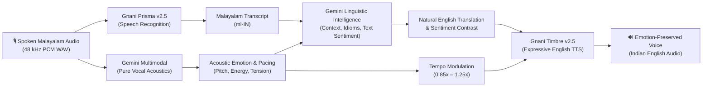

# VibeLingual — Beyond Words. Beyond Translation.

> **An emotion-aware Malayalam-to-English voice translation experience that preserves spoken feeling, cultural nuances, and vocal expression across languages.**

---

## 🌟 Overview

Conventional machine translation translates *words*, stripping away the speaker's vocal inflection, emotional energy, and cultural context. 

**VibeLingual** transforms voice translation into a multimodal experience:
1. **Transcribes** native Malayalam speech at 48 kHz studio resolution using **Gnani Prisma v2.5**.
2. **Perceives** acoustic emotion directly from physical vocal resonance (pitch contour, vocal tract tension, speaking pace, and energy) with zero transcript bias.
3. **Translates** context, idioms, and conversational intent using **Google Gemini Linguistic Intelligence**.
4. **Synthesizes** expressive Indian English voice using **Gnani Timbre v2.5**, modulating speech tempo dynamically to mirror the speaker's emotional state.

---

## 🏗️ Architecture & Multimodal Pipeline



---

## ✨ Key Capabilities & Innovations

### 1. Pure Acoustic Emotion Recognition (Zero Semantic Leakage)
Acoustic emotion is derived **strictly from physical audio characteristics** (harmonic stability, pitch variation, vocal cord tension, and projection). Negative or serious words spoken in a relaxed, calm tone are accurately recognized as **Calm / Neutral**, rather than erroneously flagged as Sad.

### 2. Dual Translation: Words vs. Meaning
- **Natural English Translation:** Idiomatically fluent, emotion-adapted phrasing capturing what the speaker *meant*.
- **Literal Grammatical Translation:** Word-for-word baseline exposing linguistic divergence between Malayalam and English syntax.

### 3. Sentiment Contrast Detection
Automatically highlights contrasts between vocal demeanor and semantic content (e.g. delivering heartbreaking news with quiet composure, or sharing celebration with stoic modesty).

### 4. Dynamic Speech Pacing Modulation
The English voice synthesis adapts its delivery speed based on detected acoustic energy:
- **Calm / Neutral:** Baseline 1.0x balanced conversational flow.
- **Happy / Excited:** Accelerated 1.12x–1.20x buoyant delivery.
- **Worried / Hesitant:** Measured 0.88x–0.92x reflective cadence.
- **Sad / Somber:** Subdued 0.85x–0.90x pace with extended pauses.

---

## 🎨 Visual Design System

VibeLingual features a custom dark glassmorphic design system:
- **Atmospheric Canvas:** Deep midnight black & navy (`#090812`).
- **Primary Accent:** Electric violet (`#9B6DFF`).
- **Secondary Accent:** Soft lavender (`#C5A7FF`).
- **Highlight Glow:** Luminous cyan (`#78DCE8`).
- **Surfaces:** Translucent purple glassmorphism (`backdrop-filter: blur(20px)`) with delicate borders and ambient lighting.
- **Typography:** Contemporary high-readability sans-serif (*Plus Jakarta Sans*) with monospace telemetry (*JetBrains Mono*).

---

## 🚀 Quickstart & Setup

### Prerequisites
- Python 3.10+
- Valid API credentials:
  - **Gnani AI API Key** (`GNANI_API_KEY`)
  - **Google Gemini API Key** (`GEMINI_API_KEY`)

### Installation

1. **Clone repository:**
   ```bash
   git clone https://github.com/your-username/VibeLingual.git
   cd VibeLingual
   ```

2. **Create and activate a virtual environment:**
   ```bash
   python -m venv .venv
   # Windows:
   .venv\Scripts\activate
   # macOS / Linux:
   source .venv/bin/activate
   ```

3. **Install dependencies:**
   ```bash
   pip install -r requirements.txt
   ```

4. **Configure environment variables:**
   Create a `.env` file in the root directory:
   ```env
   GNANI_API_KEY=your_gnani_token_here
   GEMINI_API_KEY=your_gemini_key_here
   ```

5. **Launch the Studio Application:**
   ```bash
   streamlit run app.py
   ```
   Open your browser at `http://localhost:8501`.

---

## 🧪 Automated Test Suite

Run the acoustic emotion verification suite:
```bash
python tests/test_neutral_vs_sad.py
```

Validates:
1. Real human conversational Malayalam audio classified as **`Calm / Neutral`**.
2. Calm delivery of tragic statements yields **`Calm / Neutral`** acoustic emotion alongside **`Sad / Somber`** text sentiment with documented contrast.
3. Calm delivery of celebratory statements yields **`Calm / Neutral`** acoustic emotion alongside **`Joyful`** text sentiment.
4. Animated vocal samples correctly trigger **`Happy / Excited`** classification.

---

## 🛡️ License

Distributed under the MIT License.

